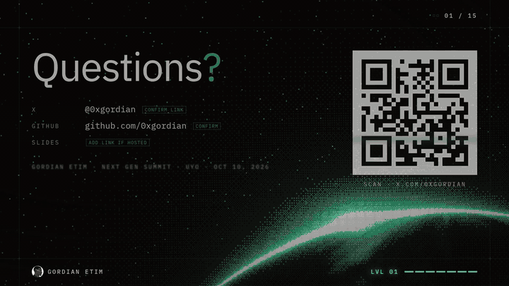

# Build, Ship, Get Picked

My talk at Next Gen Summit, Uyo, October 10, 2026.

**[Open the deck](https://summit-gordian.vercel.app)** · [PDF](https://summit-gordian.vercel.app/deck.pdf) · [Watch the preview video](https://0xgordian.github.io/next-summit-talk26/media/preview.mp4)

The market is hard and a lot of it isn't up to you. What is up to you is what you can do, what you practise on, and what people can see of your work. This talk is about building small real things, shipping them where people can use them, and making your work easy to find.

## Using the deck

It's one HTML page with no build step and no internet needed once it's loaded.

| Key | What it does |
| --- | --- |
| Space, arrows, Enter or click | Next or previous step |
| F | Fullscreen |
| N | Speaker notes |
| O | Overview of all slides |
| S | Skip the optional section |

To run it offline, download the repo and open `index.html` in Chrome.

## Files

- `index.html` and `assets/` hold the deck
- `deck.pdf` is the static backup
- `media/` has the preview video

Gordian Etim, DX and product at Aomi Labs. [@0xgordian](https://x.com/0xgordian)
